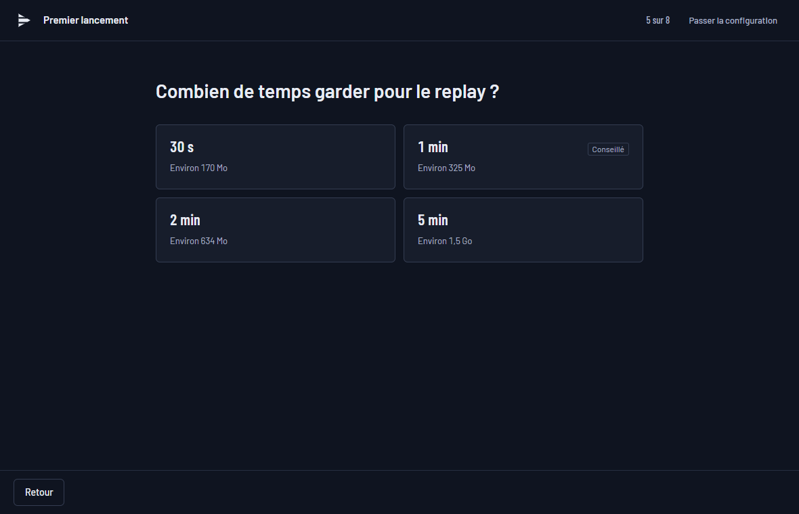

<p align="center">
  
</p>

<h1 align="center">PalaClips</h1>

<p align="center">
  Replay instantané et enregistrement d'écran pour Windows, gratuit et open source,<br>
  avec une piste audio séparée pour chaque logiciel.
</p>

<p align="center">
  <a href="https://github.com/Palawizard/PalaClips/releases/latest"></a>
  <a href="https://github.com/Palawizard/PalaClips/releases"></a>
  <a href="https://github.com/Palawizard/PalaClips/actions/workflows/ci.yml"></a>
  
  <a href="LICENSE"></a>
</p>

<p align="center"><a href="README.md">English</a> · <strong>Français</strong></p>

PalaClips garde les derniers instants de ta partie en mémoire et les sauvegarde en clip d'un
raccourci, comme le replay instantané de NVIDIA ShadowPlay ou le tampon de relecture d'OBS.
Chaque clip contient **une piste audio par logiciel** (jeu, Discord, musique, navigateur,
micro) : au montage dans DaVinci Resolve, Premiere Pro ou tout logiciel multipiste, tu coupes
le vocal ou la musique sans toucher au jeu. Il est léger, n'injecte rien dans les jeux et
fonctionne avec les anti-triches comme Easy Anti-Cheat.


## Sommaire

- [Fonctionnalités](#fonctionnalités)
- [Captures d'écran](#captures-décran)
- [Configuration requise](#configuration-requise)
- [Installation](#installation)
- [Utilisation](#utilisation)
- [Questions fréquentes](#questions-fréquentes)
- [Feuille de route](#feuille-de-route)
- [Compiler depuis les sources](#compiler-depuis-les-sources)
- [Contribuer](#contribuer)
- [Licence](#licence)

## Fonctionnalités

- **Replay instantané** : les 5 dernières secondes à 60 dernières minutes restent en mémoire ou
  sur le disque. Un raccourci (`Alt+F10` par défaut) les sauvegarde sans quitter le jeu ; un
  son et une notification confirment.
- **Enregistrement d'écran** (`Ctrl+Alt+F9`) en MP4 fragmenté, lisible même si le PC plante en
  cours de route.
- **Pistes audio séparées** : piste 1 = mix complet, piste 2 = micro, puis une piste par appli
  choisie (Discord, Spotify, navigateur...) et une piste « Jeu » qui suit le jeu au premier
  plan. Chaque piste porte son nom dans le fichier.
- **Encodage matériel** par la carte graphique (NVIDIA NVENC, AMD AMF, Intel Quick Sync) en
  H.264, HEVC ou AV1, à fps constant jusqu'à 240 i/s, écrans HDR pris en charge. Sans
  encodeur matériel, **encodage par le processeur** en H.264 ou AV1.
- **Capture d'un écran ou d'une fenêtre** par Windows Graphics Capture ; une fenêtre est
  retrouvée par le nom de son programme après un redémarrage.
- **Galerie de clips** avec un lecteur multipiste : écoute piste par piste (muet, solo,
  volume), découpe, export, copie du fichier pour le coller dans Discord.
- **Léger** : vit dans la zone de notification ; fenêtre fermée, il ne reste qu'un petit
  processus.
- **Respect de la vie privée** : aucun compte, aucune télémétrie, aucune injection dans les
  jeux.
- **Mises à jour automatiques**, vérifiées par une signature avant l'installation.
- Interface en français et en anglais.

## Captures d'écran

| Galerie | Sources audio |
|---|---|
|  |  |



## Configuration requise

- Windows 11. Windows 10 n'est pas pris en charge : la capture du son par appli demande le
  build 20348 ou plus récent.
- Une carte graphique avec un encodeur vidéo matériel (NVIDIA, AMD ou Intel) conseillée. Sans
  elle, PalaClips encode sur le processeur, ce qui coûte du CPU en jeu (voir les questions
  fréquentes).
- WebView2, déjà présent sur Windows 11 (l'installeur le télécharge s'il manque).

## Installation

1. Télécharge `PalaClips_x.y.z_x64-setup.exe` dans la
   [dernière version](https://github.com/Palawizard/PalaClips/releases/latest) et lance-le.
   L'installation se fait pour ton compte, sans droits administrateur.
2. **SmartScreen** : l'installeur n'est pas signé par un certificat payant, donc Windows peut
   afficher « Windows a protégé votre ordinateur ». Clique sur *Informations complémentaires*,
   puis sur *Exécuter quand même*.
3. Au premier lancement, PalaClips vérifie la machine, puis pose quelques questions, une à la
   fois : l'écran, le micro, le contenu de la piste 1, la durée du replay et où le garder, le
   dossier des clips et le raccourci. Un récapitulatif permet de changer chaque réponse, puis
   tu sauvegardes un vrai clip de test. Tu peux le passer : les réglages par défaut
   fonctionnent tels quels.

**Mises à jour** : PalaClips cherche les nouvelles versions sur GitHub et les installe après
vérification de leur signature, avec les notes de version.

**Désinstallation** : Paramètres Windows → Applications. Tes clips ne sont jamais supprimés ;
une case facultative efface aussi les réglages et l'historique de la galerie.

## Utilisation

| Action | Raccourci par défaut |
|---|---|
| Sauvegarder le replay | `Alt+F10` |
| Armer ou désarmer le replay | `Ctrl+Alt+F10` |
| Démarrer ou arrêter un enregistrement | `Ctrl+Alt+F9` |

Les raccourcis se changent dans Réglages → Raccourcis. Les clips vont dans
`Vidéos\PalaClips\<jeu>\`, un sous-dossier par jeu.

## Questions fréquentes

**La vidéo est figée alors que le jeu tourne.** Le jeu est en *plein écran exclusif* : dans ce
mode, Windows ne transmet plus l'image aux logiciels de capture. PalaClips le détecte et
affiche une alerte. Passe le jeu en *plein écran fenêtré* (ou *fenêtre sans bordure*) dans
ses options d'affichage. La plupart des jeux récents utilisent déjà ce mode.

**Minecraft Java en plein écran (F11).** F11 met Minecraft Java en plein écran exclusif, et la
vidéo reste figée (PalaClips affiche une alerte ; le réglage NVIDIA « Méthode de présentation
Vulkan/OpenGL » n'a rien changé dans notre essai). Joue plutôt en fenêtre agrandie, ou installe
un mod de plein écran sans bordure comme Borderless Fullscreen (Fabric) : les deux se
capturent normalement.

**Est-ce compatible avec les anti-triches ?** PalaClips n'injecte rien dans les jeux. Il
utilise seulement les API de capture de Windows (Windows Graphics Capture pour l'image,
WASAPI pour le son). Il a été testé avec Fortnite (Easy Anti-Cheat).

**Le jeu perd des fps quand la carte graphique est à fond.** Par défaut, le jeu a la priorité :
si le GPU est saturé, c'est la vidéo qui peut saccader, et une alerte le signale. Dans
Réglages → Replay & qualité, « Quand le GPU est à fond » → *Priorité à la capture* rend la
vidéo fluide, mais le jeu perd environ 7 % de fps. Limiter les fps du jeu laisse aussi de la
marge.

**Mon PC n'a pas d'encodeur vidéo sur la carte graphique.** PalaClips encode alors sur le
processeur : en H.264 par l'encodeur intégré à Windows, ou en AV1 par SVT-AV1. Le premier
lancement le signale et passe en 1080p à 30 i/s. Compte environ un cœur du processeur en
1080p30 ; un jeu déjà limité par le processeur perd des fps. Réglages → Replay & qualité →
*Encodeur* permet aussi de forcer la carte graphique ou le processeur. Si une alerte dit que le
processeur n'arrive pas à suivre, baisse la résolution ou les images par seconde (720p30 est le
plus léger). Sur une édition « N » de Windows, l'encodeur H.264 de Windows demande le Media
Feature Pack (Paramètres → Applications → Fonctionnalités facultatives) ; l'AV1 marche sans.

**Mon micro est aussi dans la piste 1.** C'est le réglage « Aussi dans Mix complet »
(Réglages → Audio), pour qu'un clip soit prêt à partager tel quel. Ta voix garde de toute
façon sa propre piste.

**La piste 1 ne contient pas les notifications ni la musique.** Par défaut, la piste 1 est la
somme des pistes choisies. Active « Audio du bureau » (Réglages → Audio) pour qu'elle contienne
tout ce que tu entends.

**Mémoire ou disque pour le replay ?** En mémoire, rien n'est écrit sur le disque tant que tu
ne sauvegardes pas, mais le replay occupe de la RAM (environ 320 Mo pour une minute en 1440p ;
l'estimation s'affiche dans Réglages → Replay & qualité). Sur le disque, la RAM reste libre
mais le replay s'écrit en continu ; c'est le bon choix pour les longues durées.

**Comment ouvrir les pistes dans DaVinci Resolve ?** Importe le clip : chaque piste audio
arrive séparément, avec son nom, déjà synchronisée avec la vidéo.

**Quelque chose ne marche pas.** Réglages → Général → Diagnostic → *Exporter...* crée un zip
avec les journaux, les réglages et les infos système. Le chemin de ton profil, le nom du PC et
le nom de ton compte y sont masqués ; *Ouvrir le zip* te montre ce que tu envoies. Joins-le à
une [issue GitHub](https://github.com/Palawizard/PalaClips/issues).

## Feuille de route

Compatibilité sur plus de systèmes, marqueurs, compression et autres pistes : voir la
[feuille de route](ROADMAP.fr.md). Les changements entre versions sont dans les
[releases](https://github.com/Palawizard/PalaClips/releases) et dans le
[journal des modifications](CHANGELOG.md).

## Compiler depuis les sources

Prérequis : Windows 11, [Rust](https://rustup.rs) (toolchain MSVC), Visual Studio Build Tools
(C++), LLVM (`winget install LLVM.LLVM`), Node.js 20.19 ou plus récent, PowerShell 7 (`pwsh`).

```powershell
git clone https://github.com/Palawizard/PalaClips.git
cd PalaClips
pwsh scripts/check-env.ps1
pwsh scripts/fetch-ffmpeg.ps1
cd app
npm ci
npm run tauri dev
```

`check-env.ps1` vérifie la machine et `fetch-ffmpeg.ps1` télécharge les bibliothèques FFmpeg
LGPL dans `third_party/`. Le banc de test du moteur se lance avec
`cargo run -p palaclips-cli -- info`.

Technologies : moteur en Rust (Windows Graphics Capture, WASAPI, FFmpeg), coque Tauri 2,
interface React et TypeScript.

| Fichier | Contenu |
|---|---|
| [`docs/SPEC.md`](docs/SPEC.md) | Tout ce que contient la V1 |
| [`docs/ARCHITECTURE.md`](docs/ARCHITECTURE.md) | Modules, threads, IPC, données |
| [`docs/PLAN.md`](docs/PLAN.md) | Phases et critères d'acceptation |
| [`docs/HANDOFF.md`](docs/HANDOFF.md) | Où on en est |
| [`docs/DECISIONS.md`](docs/DECISIONS.md) | Choix d'architecture (ADR) |
| [`docs/RESEARCH.md`](docs/RESEARCH.md) | Faits vérifiés et pièges, avec sources |
| [`docs/TESTING.md`](docs/TESTING.md) | Protocoles de test manuels |
| [`docs/DESIGN-BRIEF.md`](docs/DESIGN-BRIEF.md) | Brief pour la conception de l'interface |

## Contribuer

Les signalements de bugs et les idées sont les bienvenus dans les
[issues](https://github.com/Palawizard/PalaClips/issues) ; pour un bug, joins le zip de
diagnostic. Les pull requests visent la branche `dev` et suivent les
[Conventional Commits](https://www.conventionalcommits.org/fr/v1.0.0/). Avant d'en ouvrir une,
lance `cargo fmt`, `cargo clippy --workspace --all-targets -- -D warnings`,
`cargo test --workspace`, puis `npm run build` et `npm test` dans `app/`.

Le travail avec Claude Code suit [`CLAUDE.md`](CLAUDE.md) ; les skills de design impeccable
(`/plugin marketplace add pbakaus/impeccable`) et emil-design-eng
(`npx -y skills add emilkowalski/skill --skill emil-design-eng --agent claude-code`) sont
nécessaires pour le front.

## Licence

[MIT](LICENSE). PalaClips utilise [FFmpeg](https://ffmpeg.org) (LGPL) en bibliothèques
dynamiques ; les licences sont installées avec l'application. Construit avec
[Tauri](https://tauri.app).
