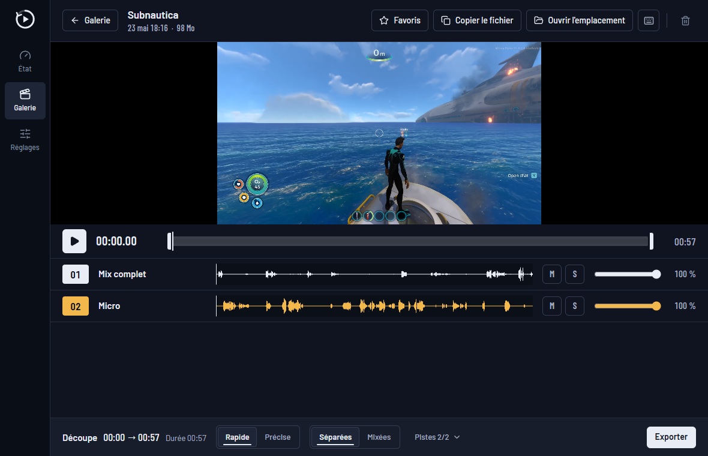
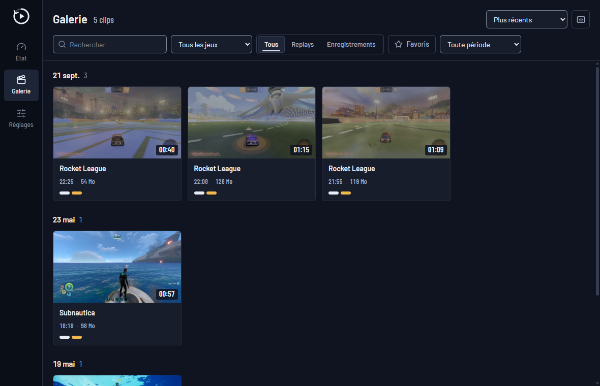
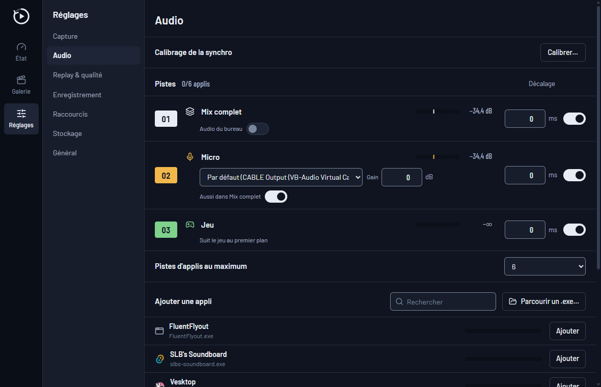
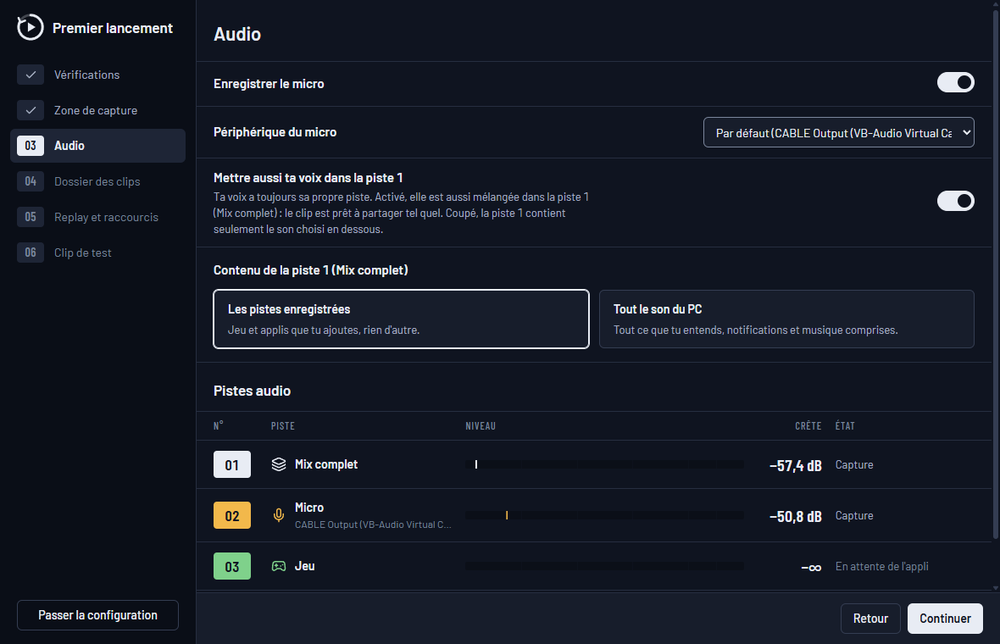

# PalaClips

[English](README.md) · **Français**

Enregistrement et **replay instantané** pour Windows, léger, gratuit et open source, avec
**une piste audio par logiciel** (jeu, Discord, musique, navigateur, micro), prête pour le
montage dans DaVinci Resolve.



## Ce que fait PalaClips

- **Replay instantané** : les dernières secondes (de 5 s à 60 min) restent en mémoire ou sur
  le disque. Un raccourci (`Alt+F10` par défaut) les sauvegarde sans quitter le jeu ; un son
  et une notification confirment.
- **Enregistrement** (`Ctrl+Alt+F9`), lisible même si le PC plante en cours de route.
- **Une piste par logiciel** : piste 1 = mix complet, piste 2 = micro, puis une piste par
  appli choisie (Discord, Spotify, navigateur…) et une piste « Jeu » qui suit le jeu au
  premier plan. Chaque piste porte son nom dans le fichier.
- Capture d'un écran ou d'une fenêtre, image fluide à fps constant, encodage par la carte
  graphique (NVIDIA NVENC, AMD AMF, Intel Quick Sync), écrans HDR pris en charge.
- **Galerie** avec lecteur : écoute piste par piste (muet, solo, volume), découpe, export,
  copie du fichier pour le coller dans Discord.
- Vit dans la zone de notification ; fenêtre fermée, il ne reste qu'un petit processus.
- **Aucune injection dans les jeux** (compatible avec les anti-triches comme Easy Anti-Cheat),
  aucun compte, aucune télémétrie.

| Galerie | Sources audio |
|---|---|
|  |  |

## Installation

1. Il faut Windows 11 (build 20348 ou plus récent) et une carte graphique avec un encodeur
   vidéo matériel (NVIDIA, AMD ou Intel).
2. Télécharge `PalaClips_x.y.z_x64-setup.exe` dans les
   [Releases](https://github.com/Palawizard/PalaClips/releases) et lance-le. L'installation se
   fait pour ton compte, sans droits administrateur. Si WebView2 manque (rare sur Windows 11),
   l'installeur le télécharge : il faut alors une connexion Internet.
3. **SmartScreen** : l'installeur n'est pas signé par un certificat payant, donc Windows peut
   afficher « Windows a protégé votre ordinateur ». Clique sur *Informations complémentaires*,
   puis sur *Exécuter quand même*.

Au premier lancement, un parcours guidé vérifie la machine et te fait choisir l'écran, le
micro, le contenu de la piste 1, le dossier des clips, la durée du replay et le raccourci,
puis te fait sauvegarder un vrai clip de test. Tu peux le passer : les réglages par défaut
fonctionnent tels quels.



**Mises à jour** : PalaClips les cherche sur GitHub et les installe après vérification de leur
signature, avec les notes de version.

**Désinstallation** : Paramètres Windows → Applications. Tes clips ne sont jamais supprimés ;
une case facultative efface aussi les réglages et l'historique de la galerie.

## Utilisation

| Action | Raccourci par défaut |
|---|---|
| Sauvegarder le replay | `Alt+F10` |
| Armer ou désarmer le replay | `Ctrl+Alt+F10` |
| Démarrer ou arrêter un enregistrement | `Ctrl+Alt+F9` |

Les raccourcis se changent dans Réglages → Raccourcis. Les clips vont dans
`Vidéos\PalaClips\<jeu>\`, un sous-dossier par jeu.

## Questions fréquentes

**La vidéo est figée alors que le jeu tourne.** Le jeu est en *plein écran exclusif* : dans ce
mode, Windows ne transmet plus l'image aux logiciels de capture. PalaClips le détecte et
affiche une alerte. Passe le jeu en *plein écran fenêtré* (ou *fenêtre sans bordure*) dans
ses options d'affichage. La plupart des jeux récents utilisent déjà ce mode.

**Minecraft Java en plein écran (F11).** Minecraft Java peut passer en plein écran exclusif
selon la carte graphique et le pilote. Si la vidéo reste figée, joue en mode fenêtré agrandi.

**Est-ce compatible avec les anti-triches ?** PalaClips n'injecte rien dans les jeux. Il
utilise seulement les API de capture de Windows (Windows Graphics Capture pour l'image,
WASAPI pour le son). Il a été testé avec Fortnite (Easy Anti-Cheat).

**Le jeu perd des fps quand la carte graphique est à fond.** Par défaut, le jeu a la priorité :
si le GPU est saturé, c'est la vidéo qui peut saccader, et une alerte le signale. Dans
Réglages → Replay & qualité, « Quand le GPU est à fond » → *Priorité à la capture* rend la
vidéo fluide, mais le jeu perd environ 7 % de fps. Limiter les fps du jeu laisse aussi de la
marge.

**Mon micro est aussi dans la piste 1.** C'est le réglage « Aussi dans Mix complet »
(Réglages → Audio), pour qu'un clip soit prêt à partager tel quel. Ta voix garde de toute
façon sa propre piste.

**La piste 1 ne contient pas les notifications ni la musique.** Par défaut, la piste 1 est la
somme des pistes choisies. Active « Audio du bureau » (Réglages → Audio) pour qu'elle contienne
tout ce que tu entends.

**Mémoire ou disque pour le replay ?** En mémoire, rien n'est écrit tant que tu ne
sauvegardes pas, mais le replay occupe de la RAM (l'estimation s'affiche dans Réglages →
Replay & qualité). Sur le disque, la RAM reste libre ; c'est le bon choix pour les longues
durées.

**Comment ouvrir les pistes dans DaVinci Resolve ?** Importe le clip : chaque piste audio
arrive séparément, avec son nom, déjà synchronisée avec la vidéo.

**Quelque chose ne marche pas.** Réglages → Général → Diagnostic → *Exporter…* crée un zip
avec les journaux, les réglages et les infos système. Le chemin de ton profil, le nom du PC et
le nom de ton compte y sont masqués ; *Ouvrir le zip* te montre ce que tu envoies. Joins-le à
une [issue GitHub](https://github.com/Palawizard/PalaClips/issues).

## Licence

[MIT](LICENSE). PalaClips utilise FFmpeg (LGPL) en bibliothèques dynamiques ; les licences
sont installées avec l'application.

## Développement

Prérequis : Windows 11, [Rust](https://rustup.rs) (toolchain MSVC), Visual Studio Build Tools
(C++), LLVM (`winget install LLVM.LLVM`), Node.js ≥ 20.19, PowerShell 7 (`pwsh`).

```powershell
git clone https://github.com/Palawizard/PalaClips.git
cd PalaClips
pwsh scripts/check-env.ps1          # vérifie la machine
pwsh scripts/fetch-ffmpeg.ps1       # FFmpeg LGPL (DLL) dans third_party/
cd app
npm ci
npm run tauri dev
```

Banc de test du moteur : `cargo run -p palaclips-cli -- info`. Le travail avec Claude Code
suit [`CLAUDE.md`](CLAUDE.md) ; les skills de design impeccable
(`/plugin marketplace add pbakaus/impeccable`) et emil-design-eng
(`npx -y skills add emilkowalski/skill --skill emil-design-eng --agent claude-code`) sont
nécessaires pour le front.

| Fichier | Contenu |
|---|---|
| [`docs/SPEC.md`](docs/SPEC.md) | Tout ce que contient la V1 |
| [`docs/ARCHITECTURE.md`](docs/ARCHITECTURE.md) | Modules, threads, IPC, données |
| [`docs/PLAN.md`](docs/PLAN.md) | Phases et critères d'acceptation |
| [`docs/HANDOFF.md`](docs/HANDOFF.md) | Où on en est |
| [`docs/DECISIONS.md`](docs/DECISIONS.md) | Choix d'architecture (ADR) |
| [`docs/RESEARCH.md`](docs/RESEARCH.md) | Faits vérifiés et pièges, avec sources |
| [`docs/TESTING.md`](docs/TESTING.md) | Protocoles de test manuels |
| [`docs/DESIGN-BRIEF.md`](docs/DESIGN-BRIEF.md) | Brief pour la conception de l'interface |
| [`docs/screenshots/fr/`](docs/screenshots) | Captures faites par `scripts/readme-screenshots.ps1` dans l'app isolée |
