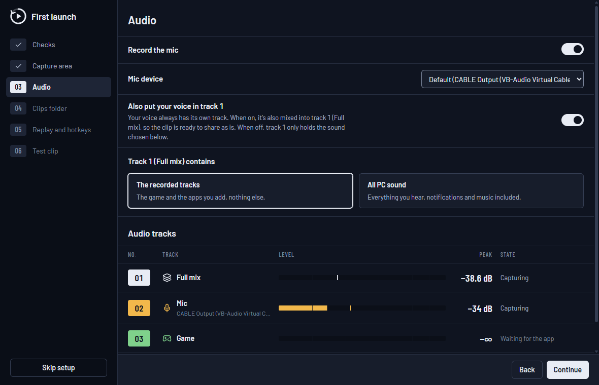

# PalaClips

**English** · [Français](README.fr.md)

Lightweight, free and open-source screen recording and **instant replay** for Windows, with
**one audio track per app** (game, Discord, music, browser, mic), ready for editing in
DaVinci Resolve.


## What PalaClips does

- **Instant replay**: the last seconds (5 s to 60 min) stay in memory or on disk. A hotkey
  (`Alt+F10` by default) saves them without leaving the game; a sound and a notification
  confirm it.
- **Recording** (`Ctrl+Alt+F9`), still readable if the PC crashes mid-way.
- **One track per app**: track 1 = full mix, track 2 = mic, then one track per app you pick
  (Discord, Spotify, browser…) and a "Game" track that follows the game in the foreground.
  Each track carries its name in the file.
- Capture a screen or a window, smooth video at a constant frame rate, encoding on the
  graphics card (NVIDIA NVENC, AMD AMF, Intel Quick Sync), HDR screens supported.
- **Gallery** with a player: listen track by track (mute, solo, volume), trim, export, copy
  the file to paste it into Discord.
- Lives in the notification area; with the window closed, only one small process remains.
- **No injection into games** (works with anti-cheats such as Easy Anti-Cheat), no account, no
  telemetry.

| Gallery | Audio sources |
|---|---|
|  |  |

## Installation

1. You need Windows 11 (Windows 10 isn't supported: per-app audio capture needs build 20348)
   and a graphics card with a hardware video encoder (NVIDIA, AMD or Intel).
2. Download `PalaClips_x.y.z_x64-setup.exe` from the
   [Releases](https://github.com/Palawizard/PalaClips/releases) and run it. It installs for
   your account, without administrator rights. If WebView2 is missing (rare on Windows 11), the
   installer downloads it, so you need an Internet connection.
3. **SmartScreen**: the installer isn't signed with a paid certificate, so Windows may show
   "Windows protected your PC". Click *More info*, then *Run anyway*.

On first launch, a guided setup checks your PC and lets you pick the screen, the mic, what
track 1 contains, the clips folder, the replay length and the hotkey, then has you save a
real test clip. You can skip it: the default settings work as they are.



**Updates**: PalaClips checks GitHub for updates and installs them after verifying their
signature, with the release notes.

**Uninstalling**: Windows Settings → Apps. Your clips are never deleted; an optional box also
removes the settings and the gallery history.

## Usage

| Action | Default hotkey |
|---|---|
| Save the replay | `Alt+F10` |
| Arm or disarm the replay | `Ctrl+Alt+F10` |
| Start or stop a recording | `Ctrl+Alt+F9` |

Change the hotkeys in Settings → Hotkeys. Clips go to `Videos\PalaClips\<game>\`, one
subfolder per game.

## FAQ

**The video is frozen while the game runs.** The game is in *exclusive fullscreen*: in this
mode, Windows stops passing the image to capture software. PalaClips detects it and shows an
alert. Switch the game to *borderless* (windowed fullscreen) in its display settings. Most
recent games already use that mode.

**Minecraft Java in fullscreen (F11).** F11 puts Minecraft Java in exclusive fullscreen, so
the video freezes (PalaClips shows an alert; the NVIDIA "Vulkan/OpenGL present method" setting
didn't help in our test). Play in a maximized window instead, or install a borderless
fullscreen mod such as Borderless Fullscreen (Fabric): both capture normally.

**Does it work with anti-cheats?** PalaClips injects nothing into games. It only uses the
Windows capture APIs (Windows Graphics Capture for the image, WASAPI for the sound). It was
tested with Fortnite (Easy Anti-Cheat).

**The game loses fps when the graphics card is maxed out.** By default the game comes first:
if the GPU is saturated, the video may stutter, and an alert says so. In Settings → Replay &
quality, "When the GPU is maxed out" → *Capture first* makes the video smooth, but the game
loses about 7% fps. Capping the game's fps also leaves headroom.

**My mic is also in track 1.** That's the "Also in Full mix" setting (Settings → Audio), so a
clip is ready to share as is. Your voice keeps its own track either way.

**Track 1 doesn't contain notifications or music.** By default, track 1 is the sum of the
tracks you picked. Turn on "Desktop audio" (Settings → Audio) to have it contain everything
you hear.

**Memory or disk for the replay?** In memory, nothing is written until you save, but the
replay takes RAM (the estimate shows in Settings → Replay & quality). On disk, RAM stays free;
it's the right choice for long durations.

**How do I open the tracks in DaVinci Resolve?** Import the clip: each audio track comes in
separately, with its name, already in sync with the video.

**Something doesn't work.** Settings → General → Diagnostics → *Export…* creates a zip with
the logs, the settings and system info. Your profile path, PC name and account name are
masked; *Open zip* shows you what you're sending. Attach it to a
[GitHub issue](https://github.com/Palawizard/PalaClips/issues).

## License

[MIT](LICENSE). PalaClips uses FFmpeg (LGPL) as dynamic libraries; the licenses are installed
with the app.

## Development

The project documentation is in French. Requirements: Windows 11,
[Rust](https://rustup.rs) (MSVC toolchain), Visual Studio Build Tools (C++), LLVM
(`winget install LLVM.LLVM`), Node.js ≥ 20.19, PowerShell 7 (`pwsh`).

```powershell
git clone https://github.com/Palawizard/PalaClips.git
cd PalaClips
pwsh scripts/check-env.ps1          # checks the machine
pwsh scripts/fetch-ffmpeg.ps1       # FFmpeg LGPL (DLLs) into third_party/
cd app
npm ci
npm run tauri dev
```

Engine test bench: `cargo run -p palaclips-cli -- info`. See [`CLAUDE.md`](CLAUDE.md) and
[`docs/`](docs) ([`SPEC`](docs/SPEC.md), [`ARCHITECTURE`](docs/ARCHITECTURE.md),
[`PLAN`](docs/PLAN.md), [`HANDOFF`](docs/HANDOFF.md)). Screenshots are made by
`scripts/readme-screenshots.ps1 -Language en` (or `fr`) in the isolated app.
