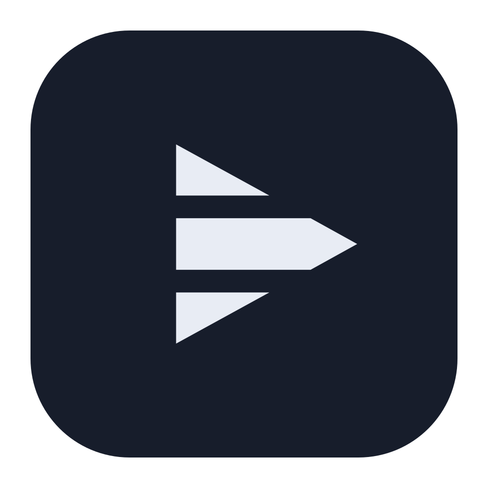
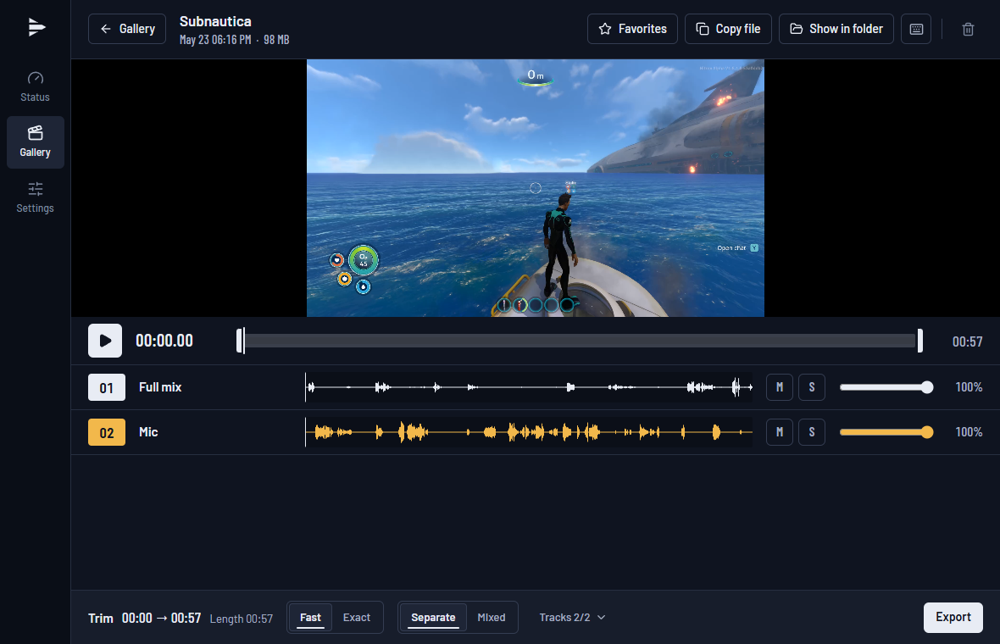
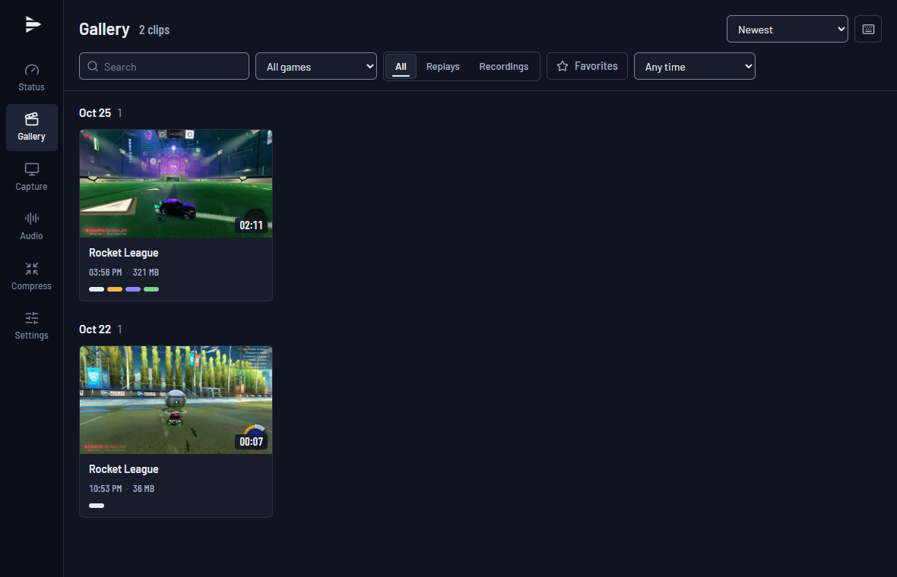
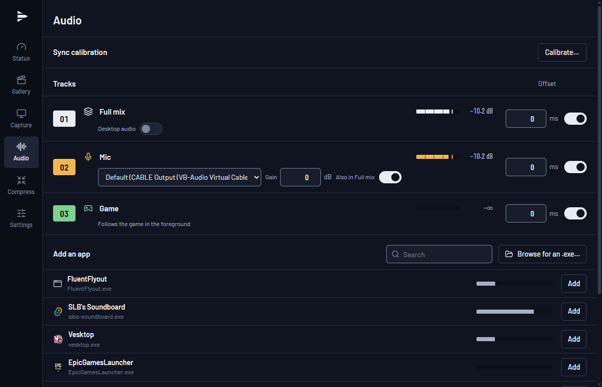
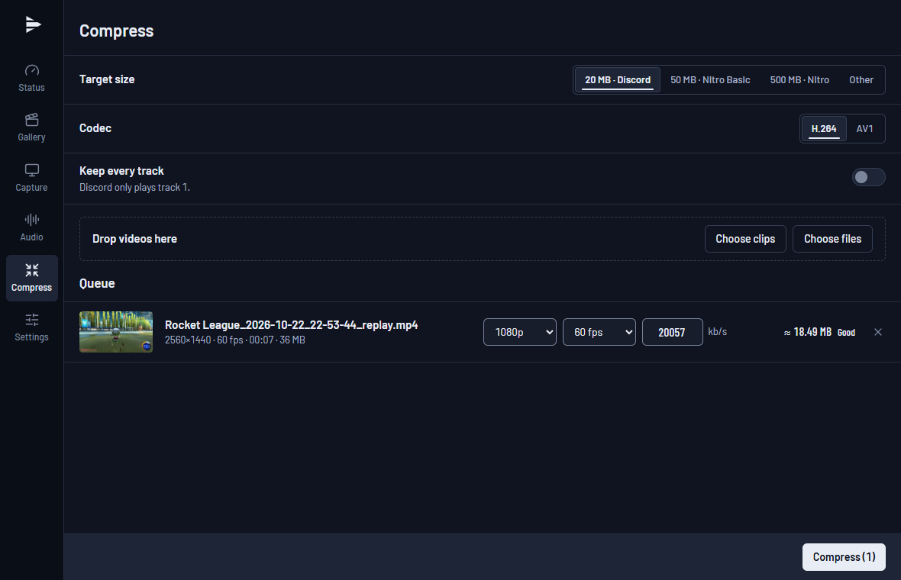
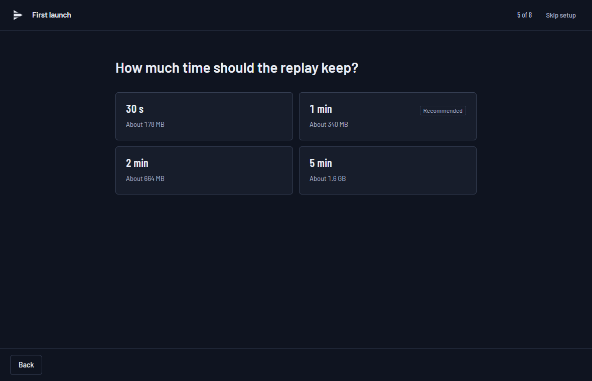

<p align="center">
  
</p>

<h1 align="center">PalaClips</h1>

<p align="center">
  Free and open-source instant replay and screen recorder for Windows,<br>
  with a separate audio track for every app.
</p>

<p align="center">
  <a href="https://github.com/Palawizard/PalaClips/releases/latest"></a>
  <a href="https://github.com/Palawizard/PalaClips/releases"></a>
  <a href="https://github.com/Palawizard/PalaClips/actions/workflows/ci.yml"></a>
  
  <a href="LICENSE"></a>
</p>

<p align="center"><strong>English</strong> · <a href="README.fr.md">Français</a></p>

PalaClips keeps the last moments of your game in a buffer and saves them as a clip with one
hotkey, like NVIDIA ShadowPlay Instant Replay or the OBS replay buffer. Every clip carries
**one audio track per app** (game, Discord, music, browser, microphone), so you can mute a
voice chat or a song when editing in DaVinci Resolve, Premiere Pro or any multitrack editor.
It is lightweight, injects nothing into games and works with anti-cheats such as Easy
Anti-Cheat.



## Table of contents

- [Features](#features)
- [Screenshots](#screenshots)
- [Requirements](#requirements)
- [Installation](#installation)
- [Usage](#usage)
- [FAQ](#faq)
- [Roadmap](#roadmap)
- [Building from source](#building-from-source)
- [Contributing](#contributing)
- [License](#license)

## Features

- **Instant replay**: the last 5 seconds to 60 minutes stay in memory or on disk. A hotkey
  (`Alt+F10` by default) saves them without leaving the game; a sound and a notification
  confirm the save.
- **After the press**: the clip can also keep going for up to 10 min after the hotkey (for
  example 1 min before + 10 s after); pressing again extends it.
- **Screen recording** (`Ctrl+Alt+F9`) in a fragmented MP4 that stays readable even if the PC
  crashes mid-way, in the replay's quality or in its own (codec, quality, frame rate,
  resolution); the replay keeps running and can still be saved during a recording.
- **Size estimate** while you change the settings: MB per minute, size of a clip, and MB per
  minute and per hour of recording.
- **Separate audio tracks**: track 1 is the full mix, track 2 the microphone, then one track
  per app you pick (Discord, Spotify, browser...), with no maximum, and a "Game" track that
  follows the game in the foreground. Each track carries its name in the file.
- **Hardware encoding** on the graphics card (NVIDIA NVENC, AMD AMF, Intel Quick Sync) in
  H.264, HEVC or AV1, at a constant frame rate up to 240 fps, with HDR screens supported.
  Without a hardware encoder, **encoding on the processor** in H.264 or AV1.
- **Screen or window capture** through Windows Graphics Capture; a window is found again by
  its program name after a restart.
- **Clip gallery** with a multitrack player: listen track by track (mute, solo, volume), trim,
  export, or copy the file to paste it into Discord.
- **Compress to a target size**: 20 MB for Discord, 50 or 500 MB for Nitro, or any size;
  resolution and frame rate follow the size, and the final size is checked. From the gallery (one
  or several clips), the player, or by dragging files from File Explorer.
- **Lightweight**: lives in the notification area; with the window closed, only one small
  process remains.
- **Private**: no account, no telemetry, no injection into games.
- **Automatic updates**, verified with a signature before they install.
- Interface in English and French.

## Screenshots

| Gallery | Audio sources |
|---|---|
|  |  |

| Compress | First launch |
|---|---|
|  |  |

## Requirements

- Windows 11. Windows 10 isn't supported: per-app audio capture needs build 20348 or later.
- A graphics card with a hardware video encoder (NVIDIA, AMD or Intel) is recommended.
  Without one, PalaClips encodes on the processor, which costs CPU in game (see the FAQ).
- WebView2, already present on Windows 11 (the installer downloads it if it's missing).

## Installation

1. Download `PalaClips_x.y.z_x64-setup.exe` from the
   [latest release](https://github.com/Palawizard/PalaClips/releases/latest) and run it. It
   installs for your account, without administrator rights.
2. **SmartScreen**: the installer isn't signed with a paid certificate, so Windows may show
   "Windows protected your PC". Click *More info*, then *Run anyway*.
3. On first launch, PalaClips checks your PC, then asks a few questions one at a time: the
   screen, the mic, what track 1 contains, the replay length and where it's kept, the clips
   folder and the hotkey. A summary lets you change any answer, then you save a real test
   clip. You can skip it: the default settings work as they are.

**Updates**: PalaClips checks GitHub for new versions and installs them after verifying their
signature, with the release notes.

**Uninstalling**: Windows Settings → Apps. Your clips are never deleted; an optional box also
removes the settings and the gallery history.

## Usage

| Action | Default hotkey |
|---|---|
| Save the replay | `Alt+F10` |
| Arm or disarm the replay | `Ctrl+Alt+F10` |
| Start or stop a recording | `Ctrl+Alt+F9` |

Change the hotkeys in Settings → Hotkeys. Clips go to `Videos\PalaClips\<game>\`, one
subfolder per game.

## FAQ

**The video is frozen while the game runs.** The game is in *exclusive fullscreen*: in this
mode, Windows stops passing the image to capture software. PalaClips detects it and shows an
alert. Switch the game to *borderless* (windowed fullscreen) in its display settings. Most
recent games already use that mode.

**Minecraft Java in fullscreen (F11).** F11 puts Minecraft Java in exclusive fullscreen, so
the video freezes (PalaClips shows an alert; the NVIDIA "Vulkan/OpenGL present method" setting
didn't help in our test). Play in a maximized window instead, or install a borderless
fullscreen mod such as Borderless Fullscreen (Fabric): both capture normally.

**Does it work with anti-cheats?** PalaClips injects nothing into games. It only uses the
Windows capture APIs (Windows Graphics Capture for the image, WASAPI for the sound). It was
tested with Fortnite (Easy Anti-Cheat).

**The game loses fps when the graphics card is maxed out.** By default the game comes first:
if the GPU is saturated, the video may stutter, and an alert says so. In Settings → Replay &
quality, "When the GPU is maxed out" → *Capture first* makes the video smooth, but the game
loses about 7% fps. Capping the game's fps also leaves headroom.

**Recording in another quality than the replay.** During such a recording a second encode
runs on the graphics card. Measured on an RTX 4070 Super in Fortnite: no measurable loss when
the second stream is lighter (for example replay 1440p60 and recording 1080p30); about 5% fps
with two full 1440p60 streams. With *Same as replay*, nothing more runs.

**How many app tracks can I add?** As many as you want. Each one costs about 5% of a
processor core, 1.4 MB of memory and up to 1.4 MB per minute of clip; the Audio page says so
past 12. A clip with 26 tracks plays, trims, exports and compresses normally.

**My PC has no video encoder on the graphics card.** PalaClips then encodes on the processor:
in H.264 with the encoder built into Windows, or in AV1 with SVT-AV1. The first launch says so
and switches to 1080p at 30 fps. Expect about one processor core at 1080p30; a game already
limited by the processor loses fps. Measured on an i5-13600KF in Fortnite capped at 225 fps:
no loss in average fps, but the slowest 1% of frames drop by 3 to 5% (none with the graphics
card). The encoder also takes memory: about 170 MB at
1080p (90 MB at 720p) in H.264, 150 MB in AV1; Settings → Replay & quality adds it to the
estimate. Settings → Replay & quality → *Encoder* also lets you
force the graphics card or the processor. If an alert says the processor can't keep up, lower
the resolution or the frame rate (720p30 is the lightest). 

**Windows "N" or "KN" edition (Europe, Korea).** These editions ship without Media Foundation,
so the Windows H.264 encoder is missing until you install the Media Feature Pack (Settings →
Apps → Optional features). Without it, PalaClips switches to AV1 on the processor on its own;
install the pack to get H.264 back.

**My mic is also in track 1.** That's the "Also in Full mix" setting (Audio page), so a
clip is ready to share as is. Your voice keeps its own track either way.

**Track 1 doesn't contain notifications or music.** By default, track 1 is the sum of the
tracks you picked. Turn on "Desktop audio" (Audio page) to have it contain everything
you hear.

**Memory or disk for the replay?** In memory, nothing is written to the disk until you save,
but the replay takes RAM (about 320 MB for one minute at 1440p; the estimate shows in
Settings → Replay & quality). On disk, RAM stays free but the replay is written continuously;
it's the right choice for long durations.

**How do I open the tracks in DaVinci Resolve?** Import the clip: each audio track comes in
separately, with its name, already in sync with the video.

**Something doesn't work.** Settings → General → Diagnostics → *Export...* creates a zip with
the logs, the settings and system info. Your profile path, PC name and account name are
masked; *Open zip* shows you what you're sending. Attach it to a
[GitHub issue](https://github.com/Palawizard/PalaClips/issues).

## Roadmap

Compatibility on more systems, markers, compression and other leads: see the
[roadmap](ROADMAP.md). Changes between versions are listed in the
[releases](https://github.com/Palawizard/PalaClips/releases) and in the
[changelog](CHANGELOG.md).

## Building from source

The project documentation is in French. Requirements: Windows 11,
[Rust](https://rustup.rs) (MSVC toolchain), Visual Studio Build Tools (C++), LLVM
(`winget install LLVM.LLVM`), Node.js 20.19 or later, PowerShell 7 (`pwsh`).

```powershell
git clone https://github.com/Palawizard/PalaClips.git
cd PalaClips
pwsh scripts/check-env.ps1
pwsh scripts/fetch-ffmpeg.ps1
cd app
npm ci
npm run tauri dev
```

`check-env.ps1` checks the machine and `fetch-ffmpeg.ps1` downloads the FFmpeg LGPL libraries
into `third_party/`. The engine test bench runs with `cargo run -p palaclips-cli -- info`.
Architecture and decisions are in [`docs/`](docs) ([`SPEC`](docs/SPEC.md),
[`ARCHITECTURE`](docs/ARCHITECTURE.md), [`DECISIONS`](docs/DECISIONS.md)).

Stack: Rust engine (Windows Graphics Capture, WASAPI, FFmpeg), Tauri 2 shell, React and
TypeScript interface.

## Contributing

Bug reports and ideas are welcome in the
[issues](https://github.com/Palawizard/PalaClips/issues); attach the diagnostic zip for a bug.
Pull requests target the `dev` branch and use
[Conventional Commits](https://www.conventionalcommits.org/en/v1.0.0/). Before opening one,
run `cargo fmt`, `cargo clippy --workspace --all-targets -- -D warnings`,
`cargo test --workspace`, then `npm run build` and `npm test` in `app/`.

## License

[MIT](LICENSE). PalaClips uses [FFmpeg](https://ffmpeg.org) (LGPL) as dynamic libraries; the
licenses are installed with the app. Built with [Tauri](https://tauri.app).
